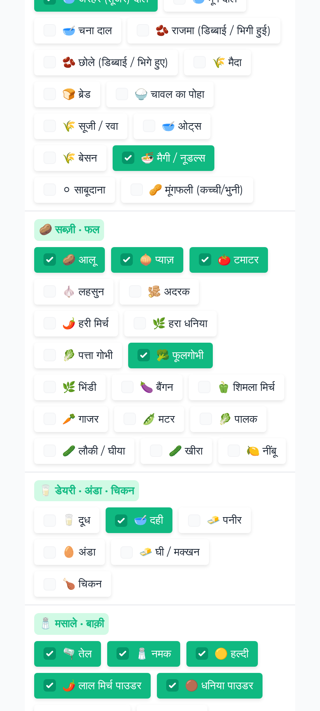
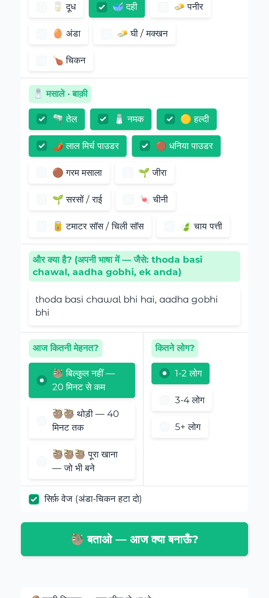
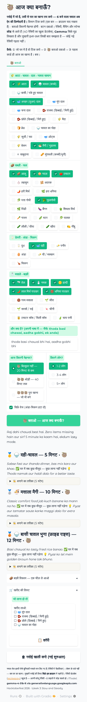
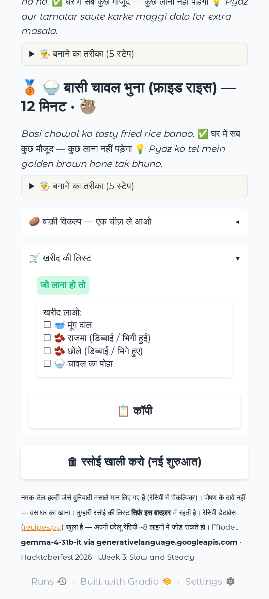

# 🦥 आज क्या बनाऊँ? (Aaj Kya Banau?)

**"Aaj kya banau?" — the 6 PM question that eats more energy than the cooking itself. This app answers it from what's already in your kitchen.**

Tick your kitchen once (the browser remembers it), say how lazy you feel today, press one button. A deterministic matcher picks tonight's top 3 from a **40-recipe open database** — ranked by fewest things missing and least effort — plus an "एक चीज़ ले आओ" (bring just one thing) shortlist. Gemma only writes the mood: a Hinglish verdict, a one-line pitch and a chef tip per dish, and it parses your messy free-text ("thoda basi chawal, aadha gobhi") onto the ingredient vocabulary. **The model never chooses recipes and never invents ingredients** — every id in its output is clamped to the database.

- **Live app:** https://aaj-kya-banau.onrender.com/
- **Built for:** [Hacktoberfest 2026 · Week 3: Slow and Steady](https://dev.to/challenges/hacktoberfest-week3-2026-10-19) — open AI that *rewards laziness*
- **Stack:** Python + Gradio (UI, BrowserState persistence) · Gemma (mood + parsing only) · deterministic matcher (all decisions) · Render

## Why a sloth decides your dinner

- **Decision fatigue is the real cost of cooking.** The app takes the choice off your plate: the first card *is* tonight's dinner.
- **Zero-typing input.** 52 common Indian-kitchen ingredients as checkboxes, remembered in your browser. Free text is optional, and only for the weird leftovers ("basi chawal").
- **Lazy-honest ranking.** "आज कितनी मेहनत?" — pick *kam* and nothing above effort 2/5 is suggested (unless nothing at all fits, then it says so and relaxes the bar, loudly).
- **"एक चीज़ ले आओ".** Nothing perfect? It shows what's one ingredient away instead of pretending you have options.
- **Model down ≠ dinner down.** No API key or no network? The matcher still decides; pitches/tips come from the recipe database itself (`mock` mode).
- **Your kitchen never leaves your browser** — BrowserState, no accounts, no server-side storage.

## How it works

```
ticks (4 groups × 52 ingredients)  +  free text "और क्या है?"
        │                                     │
        │                                     ├─ kitchen.parse_extras()   deterministic: Hindi labels
        │                                     │   + Roman aliases, longest-match first, no network
        ▼                                     ▼
        ┌──────────────────── kitchen.match() ────────────────────┐
        │  missing ≤ 0 → perfect   ·   missing 1 → "one away"     │
        │  rank: missing → effort-fit (sloth level) → effort → min│
        └───────────────┬─────────────────────────────┬───────────┘
                        ▼                             ▼
              top 3 recipe cards            one-away / far shortlist
                        │
              Gemma (one JSON call): verdict + pitch/tip per recipe
              + parse of genuinely messy free text  ──►  clamped to
              recipe ids + ingredient ids from THIS repo
```

Files: [`kitchen.py`](kitchen.py) (52-ingredient vocabulary + matcher) · [`recipes.py`](recipes.py) (40 recipes — plain, editable Python) · [`prompts.py`](prompts.py) (prompt + clamp + offline fallback) · [`llm.py`](llm.py) (provider adapter, mock mode) · [`app.py`](app.py) (UI + `/health`).

## Screenshots

| | |
|---|---|
|  |  |
| *Tick your kitchen — the browser remembers it* | *Free text + "आज कितनी मेहनत?"* |
|  |  |
| *Tonight's verdict + top 3 cards* | *"एक चीज़ ले आओ" + खरीद की लिस्ट* |

## Run it

```bash
pip install -r requirements.txt
python3 test_app.py        # 45 offline checks — no key, no network
python3 app.py             # http://localhost:7860  (mock mode, still decides dinner)
```

For the Gemma mood layer, copy `.env.example` to `.env` and add a Gemini API key (`LLM_API_KEY`). Any OpenAI-compatible endpoint works (`LLM_BASE_URL`), including local Ollama.

**Render deploy:** the repo ships a [`render.yaml`](render.yaml) Blueprint — create the service, set `LLM_API_KEY` as a secret, done.

## Contribute a family recipe

The database is deliberately boring Python — no JSON, no schema. In [`recipes.py`](recipes.py):

```python
R("gobhi_paratha", "गोभी पराठा", "🫓", ["atta", "phool_gobhi"], ["pyaz", "adrak", "lasun", "namak", "tel"],
  3, 40, True,
  ["Gobhi kaddukas karke namak laga ke 10 minute chhod do.",
   "Atta gundh ke parathe banao, bhigote bhar lo.",
   "Tawe par ghee ke saath sunhare ho tak seko."],
  "Sunday-feeling dinner, aaj hi bana lo.",
  "Kaddukas geela lage to kapde mein kas ke nikaal do — paratha phulega.")
```

`req` = must-have hero ingredients (basic masala like namak/tel/haldi is assumed optional), `opt` = nice-to-have. `verify()` runs on import and refuses the app to start with a bad id — PRs that break the kitchen, break the tests.

## License

MIT — recipes included. Cook them, fork them.
